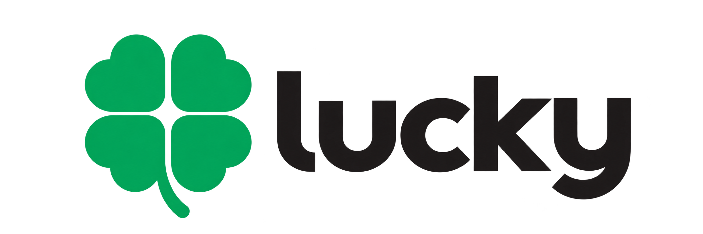

<p align="center">
  
</p>

# Lucky

Lucky is a programming language derived from Go, aimed at high-performance
applications, games, cross-platform GUIs and private AI. It keeps Go's syntax,
modules and cross-compilation, and replaces the garbage collector with ownership,
regions and explicit deallocation, checked statically wherever possible.

> **Status: pre-alpha.** The language, runtime and SDK are not implemented yet.
> This repository currently holds the reproducible upstream baseline the work
> starts from (task LUCKY-001). The goals below are design commitments, not
> features you can use today.

## Goals

- **No garbage collector, in any profile.** Lucky programs, the runtime and bundled
  libraries contain no tracing or cycle collector. There is no GC fallback,
  hybrid runtime or legacy GC mode.
- **Go compatibility under that rule.** `.go` files keep Go's grammar, and `.lk`
  files (proposed) enable the Lucky edition. Each dependency is certified,
  covered by verified contracts, ported without GC, or rejected with a diagnostic.
- **Memory control in the language.** Single owners and borrows, regions,
  generational handles, explicit allocators, stack and allocation contracts, and
  predictable layout for FFI and GPU.
- **Expressive types.** Enums with payloads and exhaustive matching, and `Result`
  with `?` propagation alongside Go's `(T, error)`.
- **Controllable concurrency.** async/await and goroutines, with `native`,
  `hosted` and `freestanding` runtime profiles.
- **Games, GUI and AI.** Data-oriented design (SoA, ECS), a GUI built on Fyne for
  desktop, mobile and the browser (WebGL), and tacScript, built on TAC Lang, for
  typed private-AI workflows.

## Foundations

| Component | Upstream | Pinned version |
| --- | --- | --- |
| Compiler, runtime and tools | [golang/go](https://github.com/golang/go) | go1.27.3 |
| GUI | [fyne-io/fyne](https://github.com/fyne-io/fyne) | v2.8.2 |
| tacScript | [TacFlow/tac-language](https://github.com/TacFlow/tac-language) | v0.5.0 |
| Design reference for ownership, types and async | [rust-lang/rust](https://github.com/rust-lang/rust) | 1.99.1 (reference only) |

Exact commits are pinned in [`infra/baseline/upstreams.lock`](infra/baseline/upstreams.lock).

## Repository layout

| Path | Contents |
| --- | --- |
| [`infra/baseline/`](infra/baseline/) | Scripts that fetch, build and test the pinned upstream baseline |
| `infra/evidence/` | Evidence from each baseline run: environment, stage status, logs, artifact hashes and target matrix |
| [`assets/`](assets/) | Official logo and symbol |

## Reproducing the baseline

```sh
infra/baseline/run.sh --clean
```

This requires `git`, `curl`, a C compiler and any `go` 1.21 or later on `PATH`.
That `go` is used only to download the pinned bootstrap toolchain, go1.26.10. A
run uses about 4 GB in `.work/`. The script exits with 0 when every stage
passed, 1 when one failed and 2 when one was skipped. The binaries it builds
are upstream Go, Fyne and TAC, which still use a garbage collector. They are a
reference for comparison, not Lucky artifacts. Details are in
[`infra/baseline/README.md`](infra/baseline/README.md).

## Logo

| Logo | Symbol |
| :---: | :---: |
|  |  |
| [`assets/lucky-logo.png`](assets/lucky-logo.png) | [`assets/lucky-symbol.png`](assets/lucky-symbol.png) |

Both files have a transparent background.

## License

Lucky is released under the [MIT License](LICENSE). Upstream components keep
their own licenses: Go and Fyne use BSD-3-Clause, and TAC Lang uses MIT.
